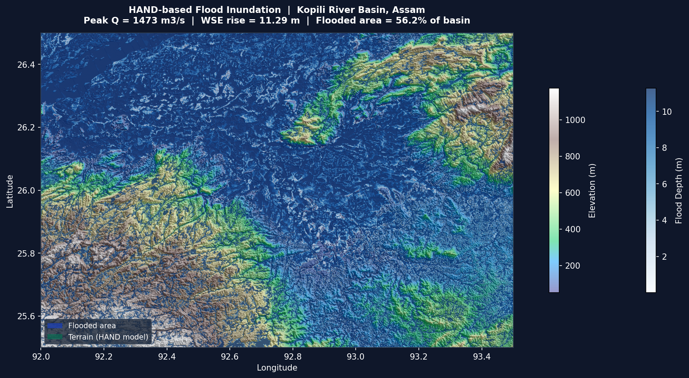

# Mathematical Digital Twin for Assam Flood Prediction & Safe Evacuation Routing

A browser dashboard and geospatial workflow for exploring flood scenarios and evacuation routes in Assam, currently focused on the Kopili River Basin.



*Example modeled visualization included with the project. It does not show current flood conditions and is not validated emergency guidance.*

## Try the project

**[Open the live dashboard](https://mo615-dev.github.io/assam-flood-early-warning/)** · [View the source on GitHub](https://github.com/MO615-dev/assam-flood-early-warning)

> **Safety:** This is a modeling prototype and demonstration, not a live flood forecast, warning service, or verified evacuation tool. The hosted dashboard uses prepared data and simulated controls; it does not ingest live rainfall or gauge feeds, contact responders, or send SMS. Do not use its maps or routes for emergency decisions. Follow official warnings and local authorities.

## What you can explore

- View prepared flood-depth and terrain layers for the Kopili Basin.
- Explore example rainfall-to-runoff calculations and discharge series.
- See a Kalman-filter gauge-assimilation demonstration using prepared or synthetic observations.
- Inspect road-network and flood-threshold route scenarios.
- Use the dashboard’s map, charts, timeline and simulated alert interactions.

## Quick start

The fastest way to try the project is the [hosted dashboard](https://mo615-dev.github.io/assam-flood-early-warning/).

To run the static dashboard locally, install Python 3 and start a local web server:

```bash
python -m http.server 8080 --directory webapp
```

Then open <http://localhost:8080>.

## How it works

The Python workflow combines rainfall-to-runoff calculations, terrain-based HAND (Height Above Nearest Drainage) analysis, a gauge-assimilation example, and road-network graph analysis. Prepared outputs are bundled with the dashboard so visitors can explore the interface without running the geospatial pipeline. GitHub Pages serves the static front end; it does not run Python processing or provide a live data connection.

The current system is an early prototype rather than a continuously synchronized digital twin. Results depend on input data, model assumptions, terrain resolution and selected thresholds. The repository does not establish independent validation against authoritative gauges, observed flood extents, or field-verified routes.

## Run the data-processing workflow

Python 3.10 or later is recommended. Rasterio and other geospatial packages may need platform-specific system libraries; on Windows, a Conda environment using `conda-forge` is often convenient.

```bash
python -m venv .venv
# Windows PowerShell: .venv\Scripts\Activate.ps1
# macOS/Linux: source .venv/bin/activate
python -m pip install -r requirements.txt
python run_full_pipeline.py
```

Some pipeline stages download data and need an internet connection, storage and memory. Review each provider’s terms and attribution requirements before redistributing source data.

## Project structure

| Path | Purpose |
| --- | --- |
| `webapp/` | Static dashboard and prepared data deployed to GitHub Pages |
| `run_full_pipeline.py` | Runs the Python processing stages |
| `rainfall_runoff.py`, `flood_hand.py` | Runoff and HAND terrain analysis |
| `sensor_assimilation.py`, `flood_routing.py` | Gauge-assimilation example and route analysis |
| `prepare_*.py` | Prepares outputs for the dashboard |
| `.github/workflows/pages.yml` | Deploys `webapp/` to Pages when changes reach `main` |

## Data, tools and acknowledgements

The workflow references CHIRPS rainfall, Copernicus DEM data, HydroSHEDS hydrography and OpenStreetMap infrastructure. Thanks to those projects and their contributors for making data and software available. Coverage, dates, licensing and attribution requirements vary by source; consult the providers before reuse.

The processing workflow uses Python geospatial and scientific libraries, including Rasterio, GeoPandas, Shapely, NumPy, SciPy, Pandas and NetworkX. The browser dashboard uses Leaflet and Chart.js. Bundled third-party assets remain subject to their respective licenses.

## License

This repository has no selected license. Public visibility alone does not grant permission to reuse its code. Data and bundled dependencies may have separate terms.
